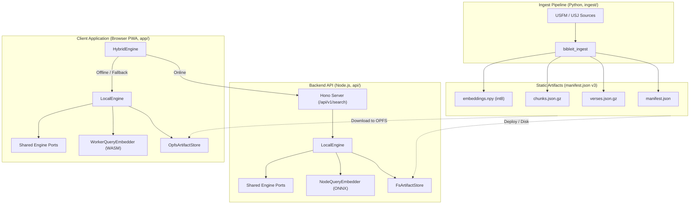

# bibleit: Architecture

## Overview

`bibleit` is an offline-first Bible search application with tiered hybrid retrieval. It combines exact reference parsing, lexical BM25 search, and on-device dense vector semantic search.

The system consists of four workspace packages:
- **`engine/` (`@bibleit/engine`)**: Shared TypeScript retrieval engine implementing core algorithms and port interfaces.
- **`app/`**: Progressive Web App (PWA) built with Vite and Preact. Runs fully client-side using OPFS and Web Workers.
- **`api/` (`@bibleit/api`)**: Node.js HTTP server (Hono) exposing `/api/v1/search` for cloud-assisted search.
- **`ingest/` (`bibleit_ingest`)**: Offline Python pipeline parsing USFM sources and producing versioned artifacts.

---

## System Topology



---

## Architectural Principles

1. **Tiered Hybrid Search**:
   The client queries the remote backend API first when online. If offline, on network failure, or in device-only mode, search falls back seamlessly to `LocalEngine` with zero user disruption.
2. **Shared Engine Package**:
   `LocalEngine` lives in `@bibleit/engine` and executes identically in Node.js and the browser.
3. **Strict Hexagonal Boundaries**:
   Core logic depends strictly on abstract interfaces (ports). Implementations (adapters) are injected exclusively at composition roots (`app/src/composition.ts` and `api/src/index.ts`).
4. **Decoupled Artifact Seam**:
   Ingest, backend, and frontend communicate only through versioned artifacts governed by `manifest.json`.

---

## Component Ports & Adapters

The UI and API communicate through a single entry port: `SearchEngine`.

| Port | Browser Adapter (`app/`) | Server Adapter (`api/`) | Role |
| :--- | :--- | :--- | :--- |
| `SearchEngine` | `HybridEngine` (wraps `LocalEngine`) | `LocalEngine` | Top-level retrieval orchestrator. |
| `ArtifactStore` | `OpfsArtifactStore` | `FsArtifactStore` / `HttpArtifactStore` | Loads manifest, text, chunks, and embeddings. |
| `QueryEmbedder` | `WorkerQueryEmbedder` (WASM via Worker) | `NodeQueryEmbedder` (Native ONNX) | Encodes query into dense vector embedding. |
| `RefParser` | `RegexRefParser` | `RegexRefParser` | Extracts exact references (e.g. *John 3:16*). |
| `LexicalIndex` | `MiniSearchLexicalIndex` | `MiniSearchLexicalIndex` | BM25 keyword matching over verses. |
| `VectorIndex` | `BruteForceVectorIndex` | `BruteForceVectorIndex` | Cosine similarity over precomputed embeddings. |
| `Ranker` | `RrfRanker` | `RrfRanker` | Fuses reference, lexical, and vector ranks (RRF). |
| `AnswerProvider` | `NullAnswerProvider` | `NullAnswerProvider` | Extensible QA provider (deferred). |

*Invariant*: The query model must match the corpus embedding model (`manifest.embeddings.model`). Wiring checks reject mismatched versions.

---

## Retrieval Pipeline

Every query executes through the following stages:

1. **Exact Reference Parsing**:
   Detects scripture references (e.g., `John 3:16`, `Gen 1:1-3`). Matched verses are resolved and ranked first.
2. **Dual-Path Candidate Retrieval**:
   - **Lexical**: BM25 keyword match across Bible verses.
   - **Semantic**: Query is embedded via ONNX and compared against passage chunk vectors using int8 dot products.
3. **Rank Fusion**:
   Merges candidate lists using Reciprocal Rank Fusion ($k = 60$).
4. **Provenance Tagging**:
   Results declare their origin via `SearchOriginEnum.LOCAL` or `SearchOriginEnum.REMOTE`.

---

## Artifact Contract (`manifest.json` v3)

```json
{
  "schema_version": 3,
  "translation": {
    "id": "web",
    "lang": "en",
    "name": "World English Bible",
    "license": "public domain"
  },
  "corpus": { "verses": "verses.json.gz", "count": 31095 },
  "chunks": {
    "file": "chunks.json.gz",
    "strategy": "token_window",
    "target_tokens": 128,
    "overlap_tokens": 32
  },
  "embeddings": {
    "file": "embeddings.npy",
    "model": "nomic-ai/nomic-embed-text-v1.5",
    "dim": 768,
    "query_prefix": "search_query: ",
    "quantization": { "type": "int8", "scales": "scales.npy" },
    "count": 2655
  }
}
```

### Retrieval Chunk Schema (`chunks.json.gz`)

```json
{
  "id": 0,
  "book": "JHN",
  "start": [3, 16],
  "end": [3, 18],
  "headings": [[3, 16, "For God So Loved the World"]],
  "text": "For God so loved the world..."
}
```
- Coordinates `start` and `end` use canonical `[chapter, verse]` pairs.
- Citations remain verse-precise while retrieval operates over contextual passage windows.
