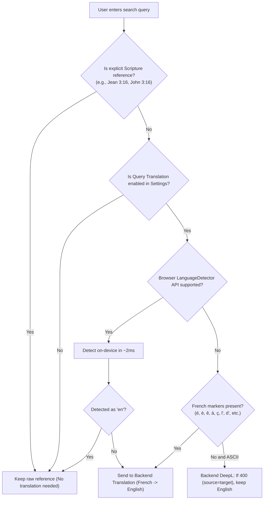

# UI Localization (i18n)

## Localized Components

All UI chrome components in `app/` are localized:
- `Navbar.tsx` (`main/navbar`)
- `Header.tsx` (`main/header`)
- `SavedView.tsx` (`saved/view`)
- `AudioPlayerBar.tsx` (`main/audioPlayerBar`)
- `FeedbackModal.tsx` (`modal/feedback`)
- `BookSelectorModal.tsx` (`modal/bookSelector`)
- `HelpModal.tsx` (`modal/help`)
- `ScriptureOverviewCard.tsx` (`search/scriptureOverviewCard`)
- `ReaderView.tsx` (`reader/view`)
- `SettingsView.tsx` (`settings/view`)
- `SearchView.tsx` (`search/view`)

## Developer Rules

1. English defaults live in component files via `i18n()`; French strings live in `app/src/locales/fr.json`.
2. Feature is gated via `VITE_MULTILINGUAL_ENABLED` (defaults to enabled in dev, disabled in prod).
3. Automatically picks up device language when enabled, or strictly falls back to English when disabled.
4. Run `npx vitest run tests/i18n-parity.test.ts` to guarantee zero missing and zero dead keys.
5. Never translate Scripture text or book names here; those belong strictly to versioned data artifacts.

---

## Cross-Lingual Query Translation Architecture

To support users searching in French (or mixed French/English) while retrieving against an English semantic/lexical corpus, queries pass through a progressive pipeline before search execution:

### Architectural Seams & Tiers:

1. **Explicit Scripture References**:
   Exact book/chapter/verse citations (e.g. `Jean 3:16`, `Romains 8:28`, `John 3:16`) bypass translation entirely via `RegexRefParser` and are addressed canonically via `VerseRef`.
2. **User Opt-Out Preference**:
   Users who prefer searching directly in English can disable automatic translation in Settings to bypass the translation layer and maximize speed (`translate: false`, `clientBypassReason: "user_opt_out"`).
3. **Client-Side Progressive Language Detection**:
   Browsers supporting on-device AI (`LanguageDetector` API) detect English locally in ~2ms. Heuristics classify unambiguous diacritics, clitics, and distinctive vocabulary (e.g., `de`, `Dieu`, `paix`), sending `translate: false` and `clientBypassReason: "client_detected_english"` when English is detected.
4. **Typed `POST /api/v1/search` Endpoint**:
   All search requests send a typed JSON body `{ query, k, locale, translate, clientBypassReason }` clamped to `MAX_SEARCH_K` (15). Legacy `GET` query-string parameters are completely removed.
5. **Dedicated Prompt Modules (`api/src/prompts/`)**:
   - `translation.ts`: `TRANSLATE_TO_ENGLISH_SYSTEM_PROMPT` instructs faithful English search keyword translation optimized for Nomic dense vector retrieval and BM25 token matching.
   - `answer.ts`: Template-based answer prompts structured via `Record<LocaleEnum, string>` dictionaries (`LANGUAGE_DIRECTIVES`, `ANSWER_INSTRUCTIONS`) and indexed by `LocaleEnum`.
6. **Backend Cascade & Strict Budget (< 2.5s)**:
   - Cascading translation across Tier 1 (Gemini Flash-Lite / Groq), Tier 2 (DeepL), and Tier 3 (MyMemory) enforces a strict combined timeout (`TRANSLATION_TIMEOUT_MS = 2400`) linked to `AbortSignal.any`.
   - If DeepL returns HTTP 400 (`"Source and target language are equal"`), `english_identity` is recorded to preserve the query directly.
7. **Hybrid Engine Offline Guard**:
   When remote search fails or times out in French mode (`LocaleEnum.FR`), `createHybridEngine` surfaces the remote error / timeout without falling back to the local English index, preventing irrelevant English keyword matches from appearing for French queries.
